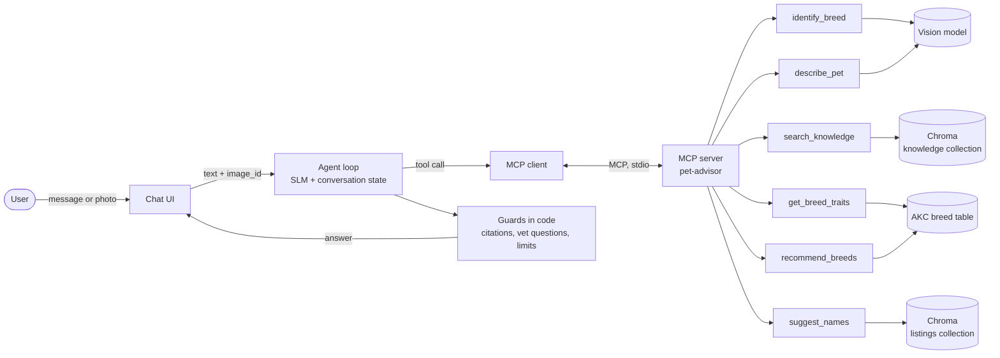
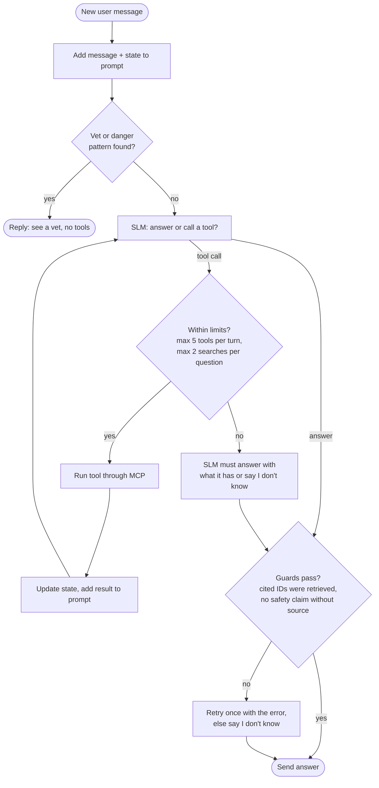

# Milestone 2 - Agent and tools

## What the agent is for

- One agent guides the user through the MVP journey: identify the breed from a photo, answer questions about it, run the fit questionnaire, recommend breeds and suggest names.
- The agent is one SLM that calls tools in a loop. It decides **what to do next**; the tools do the actual work (classify a photo, search Chroma, filter breeds, find similar pets).
- We use a single agent, not several agents talking to each other. The journey is short and linear, a small model is easier to control with one prompt, and a single tool log per conversation is easy to check against the golden journeys (Part F).
- Rule we follow everywhere: **the SLM decides what to do, code decides whether it is allowed.** Limits that protect the user (confidence threshold, search limit, citation check, vet questions) are written in code, not left to the prompt.

## Architecture



- **Chat UI:** receives text and photos. A photo is saved on disk and gets an `image_id`; only the ID travels through the agent and MCP, never the image bytes.
- **Agent loop:** sends the conversation, the state and the list of tools to the SLM, runs the tool the SLM asks for, gives the result back, and repeats until the SLM writes an answer.
- **MCP server:** one Python process that owns all the data and models the tools need. The agent never touches Chroma or the AKC table directly.
- **Guards:** checks that run in code on every answer before it reaches the user (see "Guards").

## Conversation state

The agent keeps a small state object next to the chat history:

| Field | Example | Set by |
|---|---|---|
| `current_breed` | `German Shepherd` | `identify_breed` or the user naming a breed |
| `breed_confidence` | `0.91` | `identify_breed` |
| `questionnaire` | `{home: "flat", hours_alone: 8, ...}` | Answers collected by the agent |
| `chosen_breed` | `Cavalier King Charles Spaniel` | The user, after the recommendation |
| `pet_description` | `small, brown and white, calm` | `describe_pet` or the chat |
| `rejected_names` | `["Max", "Bella"]` | The user saying no to names |

- Why: SLMs often forget or miscopy details from earlier in the chat. Keeping these values in code means a tool gets the exact breed name or questionnaire answers, and the state is added to the prompt in a short fixed format.

## Decisions the agent makes

| Decision | Options | Who decides and how |
|---|---|---|
| 1. What the user wants now | Identify breed, breed question, fit questionnaire, name suggestion, out of scope | SLM, from the message and the state. A new photo with no other text means "identify breed". |
| 2. Is the breed identification good enough? | Answer / show top 2 / ask for a clearer photo | Code: a confidence threshold tuned on golden Part A. The SLM only words the reply. |
| 3. Where to search and with which filters | Knowledge collection with or without a breed filter | SLM picks the query and the filter; code adds the breed filter automatically when `current_breed` is known (as in the RAG design). |
| 4. Search again or answer? | Answer, rewrite the query once, or say "I don't know" | SLM checks the chunks (corrective RAG); code allows at most 2 searches per question. |
| 5. Which questionnaire question to ask next | Ask a missing question / skip it / run the recommendation | SLM, but only for missing fields. If the user already said "I live in a flat", the home question is skipped. |
| 6. Is this a vet or danger question? | Normal answer / "see a vet" | Code first (a keyword and pattern check, e.g. "ate chocolate", "bleeding", "not breathing"), then the SLM. Code can force the vet reply; the SLM cannot overrule it. |
| 7. Which names to show | 5 out of the most common names among similar pets | SLM picks and explains. If the user wants other styles, it calls `suggest_names` again with the rejected names excluded. |

## Tools

We keep the number of tools small (6). With many tools a small model more often picks the wrong one or invents arguments, so each tool matches one step of the journey.

| Tool | Input | Output | Journey step | Backed by |
|---|---|---|---|---|
| `identify_breed` | `image_id` | Top 3 breeds with confidence, `is_confident` | 1. Identify breed | Vision classifier (see Model choices) |
| `search_knowledge` | `query`, optional `breed`, optional `section` | Up to 3 chunks: `chunk_id`, breed, section, text | 2. Breed questions | Chroma knowledge collection |
| `get_breed_traits` | `breed` | AKC scores: energy, shedding, grooming, trainability, demeanor, height, weight | 2. "Does it suit me?" follow-ups | AKC breed table |
| `recommend_breeds` | Questionnaire answers | Top 3 breeds, each with the traits that matched and the ones that were close | 3. Fit questionnaire | Rules + scoring on the AKC table |
| `describe_pet` | `image_id` | Species, main colour, size, short description | 4. Name suggestion | Vision model |
| `suggest_names` | `species`, `colour`, `description`, optional `exclude_names` | The most common names among the 20 most similar listings, with counts and example listing IDs | 4. Name suggestion | Chroma listings collection |

### Why `recommend_breeds` does not use the SLM

- Choosing breeds means filtering and comparing numbers (energy 1–5, weight in kg). Code does this exactly and the same way every time; a small model does not.
- Golden Part D is built from simple rules on the AKC scores, so the recommendation must follow rules we can write down and test.
- The SLM still explains the result: it calls `search_knowledge` for each of the top 3 breeds and cites the chunks, so the reasons come from sources, not from memory.

How the answers map to the AKC data:

| Question | AKC field | Rule |
|---|---|---|
| Home (flat / house / house with garden) | Energy, height, weight | Flat: remove the largest breeds; lower energy scores higher |
| Hours alone per day | Energy, demeanor | 8+ hours: remove breeds with the highest energy score |
| Daily walks | Energy | Energy should be close to the walking time the user can give |
| Kids at home | Demeanor, size | Prefer friendly demeanor; mention size in the explanation |
| Allergies | Shedding | Allergies: remove breeds with high shedding |
| Experience with dogs | Trainability | First dog: prefer easy-to-train breeds |

- "Remove" rules are hard filters (a breed that breaks them can never appear). The others give a score; the top 3 by score are returned.

### How the tools are designed

- **Clear names and short descriptions**, each with one example call. The description says when to use the tool, not only what it does.
- **Typed inputs** (JSON schema from Python type hints), with fixed choices where possible, e.g. `home: "flat" | "house" | "house_with_garden"`.
- **Short outputs** with IDs. Every chunk and listing has its ID, so the citation check can verify it later. Long text is cut so tool results do not fill the SLM's context.
- **Errors the agent can act on.** If a breed name is unknown, `get_breed_traits` returns `breed_not_found` with the 3 closest names instead of crashing, so the agent can ask "Did you mean Shiba Inu?".
- **Stateless tools.** Every input is passed explicitly, so each tool can be tested on its own.
- **Images by ID.** Tools take an `image_id`, because asking an SLM to copy a long base64 string into a tool call breaks easily.

## Agent loop



- The limits stop the SLM from looping on the same tool and keep response time predictable.
- If the SLM writes an invalid tool call (wrong JSON or a missing argument), the error is sent back to it once; a second failure ends the turn with a short apology and is logged.

### Example: the MVP journey as tool calls

| User says | Agent does | Tools called |
|---|---|---|
| *(photo of a dog)* "What breed is this?" | Identifies the breed, confidence 0.91, gives a short profile | `identify_breed` → `search_knowledge(breed="German Shepherd", section="Overview")` |
| "Is it OK in a flat?" | Answers from the exercise and space sections, with citations | `get_breed_traits` → `search_knowledge(breed="German Shepherd", section="Exercise")` |
| "I live in a flat, which dog would suit me?" | Home is already known, so asks the other 5 questions | none |
| *(answers the questions)* | Recommends 3 breeds and explains each | `recommend_breeds` → `search_knowledge` × 3 |
| "I'll take the Cavalier. Name ideas?" | Uses the chosen breed and the description from the chat | `suggest_names` |
| "Something more unusual" | New suggestions without the rejected names | `suggest_names(exclude_names=[...])` |

This table is also the format of the golden journeys in Part F: the expected tools in order and the final outcome.

## MCP server

- **One server, `pet-advisor`,** written in Python with the official MCP SDK (`FastMCP`). It exposes the 6 tools above.
- It also exposes one **resource**, `breeds://list`, with all supported breed names, so a client can check spelling or show a breed picker without a tool call.
- **Transport:** stdio. The agent starts the server as a subprocess on the same laptop, so there is no network setup. If the UI later runs as a separate service, the same server can switch to streamable HTTP without changing the tools.
- **On the agent side,** the MCP client lists the tools at start-up and converts their schemas into the function-calling format of the SLM's API (LM Studio serves an OpenAI-compatible API with tool support).

Example of how a tool is defined:

```python
from mcp.server.fastmcp import FastMCP

mcp = FastMCP("pet-advisor")

@mcp.tool()
def search_knowledge(query: str, breed: str | None = None,
                     section: str | None = None) -> list[dict]:
    """Search breed profiles (facts, care, temperament, exercise).
    Use for any question about a breed. Pass `breed` when it is known.
    Example: search_knowledge("how much exercise", breed="Siberian Husky")
    """
    where = {"breed": breed} if breed else None
    return knowledge.search("search_query: " + query, where=where, k=3)
```

### Why MCP

- **Tools are separate from the agent.** We can change the SLM or the agent prompt without touching the tools, and change a tool without touching the agent. This matters because we compare several SLMs and RAG versions.
- **Each tool can be tested alone** with the MCP Inspector or pytest, before the agent uses it.
- **Any MCP client can use the server.** During development we can connect it to an existing MCP client (for example Claude Desktop) to check that the tools give good results with a strong model, which tells us whether a failure comes from the tool or from our SLM.
- **Teammates work in parallel.** The tool names and schemas are the agreement between the RAG part, the vision part and the agent part.

### Project layout

```
mcp_server/
  server.py            # FastMCP server, tool and resource definitions
  tools/
    breed_id.py        # identify_breed, describe_pet
    knowledge.py       # search_knowledge (Chroma knowledge collection)
    traits.py          # get_breed_traits, recommend_breeds (AKC table)
    names.py           # suggest_names (Chroma listings collection)
agent/
  loop.py              # agent loop, limits, retries
  state.py             # conversation state
  guards.py            # citation check, vet check
  prompts/system.md
```

## Guards

- **Citation check:** every chunk ID in the answer must be among the IDs returned by tools in this turn (from the RAG design).
- **Vet questions:** health emergencies and "my dog ate X" questions always get "contact a vet". The assistant never says an animal or a food is safe without a source.
- **Low confidence:** under the threshold, the agent shows the top 2 breeds or asks for another photo instead of naming one breed.
- **Out of scope:** cats, wild animals and adoption are later extensions. The agent says so in one sentence instead of guessing.

## How we evaluate the agent

- Every tool call is logged as JSON (tool, arguments, result IDs, time), so a full conversation can be compared with the golden journeys.

| What we measure | How | Golden part |
|---|---|---|
| Journeys completed with the right tools | The expected tools appear in the right order and the final outcome is correct; harmless extra calls are allowed | F |
| Correct decline | "See a vet" or "I don't know" when expected | C |
| Tool choice per turn | The first tool called matches the expected one | F |
| Invalid tool calls | % of calls with bad JSON or wrong arguments | all |
| Cost | Tool calls, SLM calls and seconds per journey | all |

Experiments (one change at a time, same golden set):

1. **SLM tool calling vs a rule-based router.** The baseline picks the tool with simple rules (photo → `identify_breed`, the word "name" → `suggest_names`, ...). This shows whether letting the SLM choose is worth it.
2. **Tool descriptions:** short descriptions vs descriptions with an example call, to see how much the example reduces wrong calls.
3. **SLMs:** the candidate models from Model choices, compared on the metrics above.
