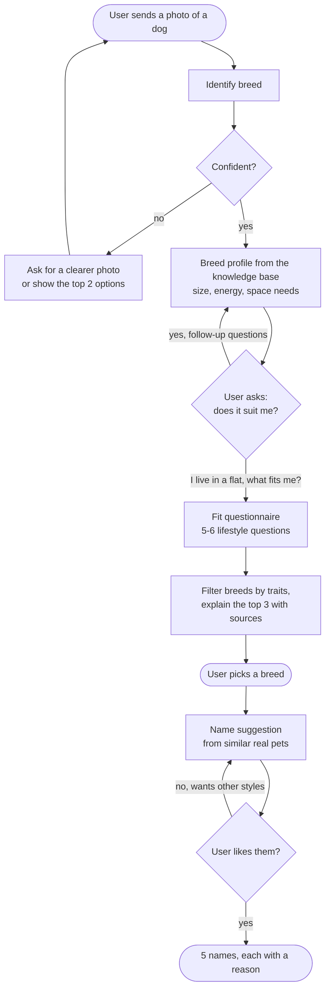
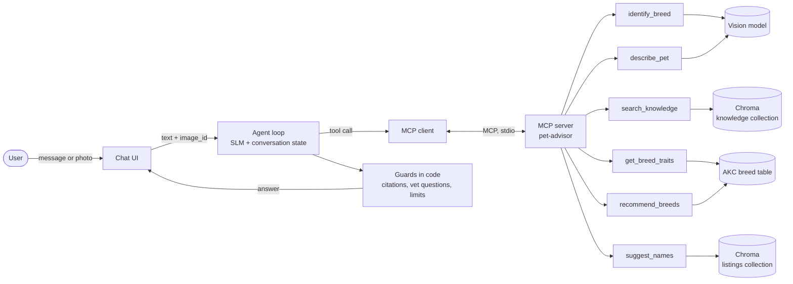
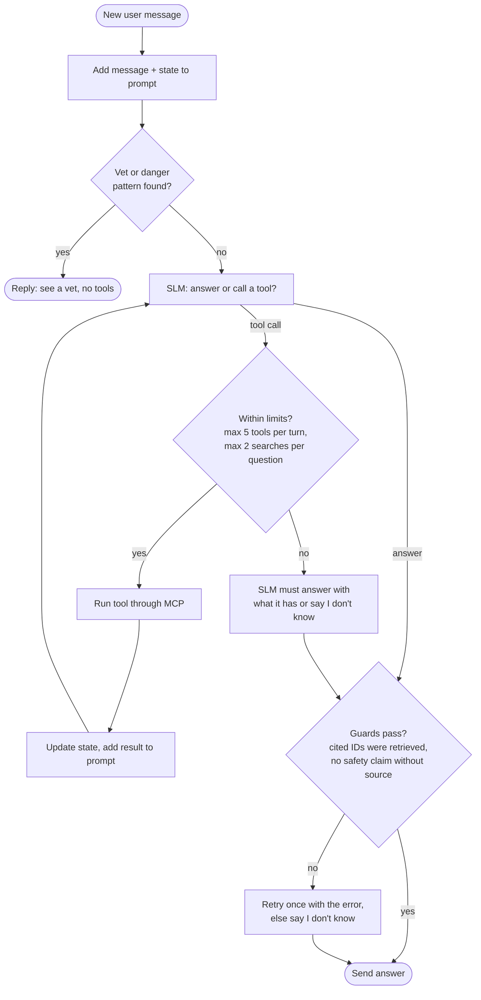
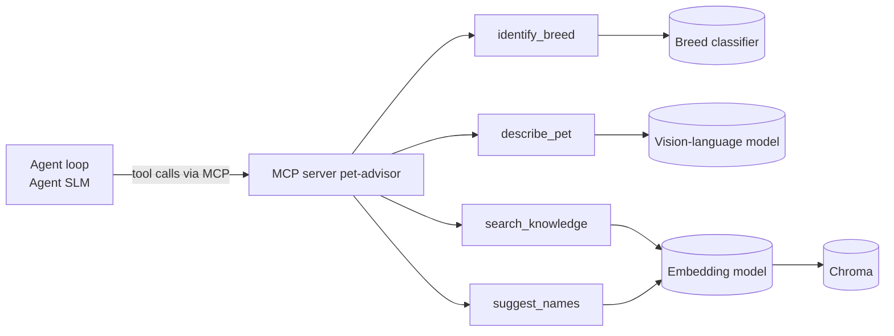

## Problem and data

### MVP user journey

A user sees a dog on the street, takes a photo and asks what breed it is. The agent answers "German Shepherd" and explains that it is very active and needs a lot of space. The user says they live in a flat and asks which breeds would suit them. The agent asks a few lifestyle questions, recommends breeds that fit, and once the user has chosen one, suggests names.



**Later extensions (not in the MVP):** cats and other species, danger warnings for wild animals, where to adopt, remembering which animals the user finds cute.

### What the system does at each step

| Step | Input | Output | Data used |
|---|---|---|---|
| 1. Identify breed | Photo | Breed, confidence, short profile | Stanford Dogs photos (only to test accuracy), knowledge collection |
| 2. Breed questions | Chat message | Answer with cited sources | Knowledge collection |
| 3. Fit questionnaire | 5–6 answers (home, time alone, walks, kids, allergies, experience) | Top 3 breeds, each with a reason | AKC breed traits, knowledge collection |
| 4. Name suggestion | Photo of the new dog, or the chosen breed plus a short description | 5 names, each with a reason | Listings collection |

### Datasets

| Dataset | Used for | Size | Why we chose it |
|---|---|---|---|
| Wikipedia breed articles + [TheDogAPI](https://thedogapi.com) | Knowledge collection (RAG) | One profile per breed | Free, covers facts, care and temperament as text |
| [AKC breed data](https://tmfilho.github.io/akcdata) | Fit questionnaire | 277 breeds | Gives numbers for energy, shedding, grooming, trainability, height and weight. A questionnaire needs values it can filter on, not free text. |
| [PetFinder.my Adoption Prediction](https://www.kaggle.com/c/petfinder-adoption-prediction) (Kaggle) | Listings collection (names) | ~15,000 dog and cat listings | The only public dataset we found with a real pet name, photo, breed, colour, size and description together |
| [Stanford Dogs](http://vision.stanford.edu/aditya86/ImageNetDogs/) | Testing breed identification | 120 breeds, 20,580 images | Standard benchmark with labelled breed photos |

- **Wikipedia + TheDogAPI:** articles and a free online database describing each dog breed (origin, size, temperament, care).
- **AKC breed data:** a table from the American Kennel Club, the largest US breed registry, that scores each breed on energy, shedding, grooming and trainability.
- **PetFinder.my:** adoption ads from a Malaysian pet adoption website, each with the pet's name, photos, breed, colour, size and the owner's description.
- **Stanford Dogs:** a research collection of dog photos, each labelled with its breed.

### Ingesting new data

To add new data, we put the new files in the `data` folder and run one script. The script checks that the files have the information we need, removes bad or duplicate entries, and adds the rest to the assistant's database (the RAG design section explains how). If an entry is already in the database, it is updated instead of added twice. At the end, the script shows how many entries were added, updated or skipped.

- **Adding a new dog breed:** we add its description and its scores. The assistant can then answer questions about it and recommend it, without any change to the code.
- **Adding another adoption website's data:** we rename its columns to match ours (name, breed, colour, size, age, description) and run the same script.

## Golden dataset

We test every step of the journey on the same fixed questions, so we can fairly compare different versions of the system.

| Part | Size | How we build it | Expected output | Metric |
|---|---|---|---|---|
| A. Breed ID | ~100 photos | Photos from the Stanford Dogs test split | The correct breed | Top-1 and top-3 accuracy; how often a wrong guess is flagged as "not sure" |
| B. Breed questions | ~60 | Pick a knowledge chunk, write a question it answers, the short answer and the chunk ID | Answer + source chunk ID | Hit rate at 1 and 3, correct facts, valid citations |
| C. Unanswerable / vet questions | ~15 | Questions our data can't answer, or that need a vet ("my dog ate chocolate") | "I don't know" or "see a vet" | % correctly declined |
| D. Fit profiles | ~20 | Questionnaire answers for realistic users (e.g. small flat, 9 hours at work, no experience) | Breeds that are acceptable + breeds that must **not** appear, decided by simple rules on the AKC scores, not by our opinion (e.g. small flat + long hours alone → no breed with the highest energy score) | No forbidden breed in the top 3; at least one acceptable breed in the top 3 |
| E. Names | ~50 | Held-out listings (photo + description) with the name hidden. These listings are removed from the listings collection. | The real name, plus a human rating | Real name in the top 5 (a weak signal); average 1–5 rating from 2 teammates who don't know which system produced the names |
| F. Full journeys | ~10 | Scripted conversations that follow the MVP journey | Correct tool order and final outcome | % of journeys completed with the right tools |

**Rules for building it:**

- Each part is written by a teammate who did not build that step, so the tests don't simply match our own system.
- An LLM may help draft paraphrases, but a person checks every item before it goes in.
- Stored in `eval/golden.jsonl` (one item per line: `id`, `part`, `input`, `expected`, `source_ids`), with photos in `eval/images/`.


## Milestone 2 - RAG design

### What RAG is used for

- We use two separate Chroma collections, because the two jobs need different data and a different kind of search. In one shared collection, adoption listings would compete with knowledge chunks for the same top results.
- Knowledge collection: breed and species profiles. Used to answer questions about facts, danger, care needs and lifestyle fit.
- Listings collection: real shelter adoption listings (name, species, breed, colour, size, description). Used to suggest names: we find pets that look and act like the user's pet and use their names.
- Name suggestion covers dogs and cats only, because the listing data only contains dogs and cats.

### Data and new data

- Knowledge sources: Wikipedia breed and species articles, TheDogAPI and TheCatAPI breed data.
- Listing sources: PetFinder.my Adoption Prediction (Kaggle, about 15,000 dog and cat listings). The final choice is made in the Problem and data section.
- Cleaning: remove duplicate documents, listings with placeholder names ("No Name", "Puppy 1") and listings for a whole litter.
- New data: add the new files to the data folder and re-run the ingestion script.
- Every chunk has a stable ID, so Chroma upsert updates existing chunks and adds new ones without creating duplicates.

### Chunking

- Knowledge: one chunk per section of a profile, for example "Siberian Husky - Exercise". Most questions ask about one topic of one breed (exercise, food, danger), so one section usually holds the whole answer.
- Sections longer than about 250 words are split again, with a small overlap, so each chunk stays focused and does not fill the prompt with unrelated text.
- Each knowledge chunk starts with the breed and section name, so a chunk such as "needs two hours of exercise a day" still says which breed it is about.
- Baseline to compare against: fixed windows of 90 words with 15 words of overlap (the Lab 3 setting). It needs no structure in the documents, so it shows whether splitting by section is worth the extra work.
- Listings: one listing = one chunk, never split, because listings are short and their fields only make sense together. The text is species, breed, colour, size, age and the description.
- The pet's name is kept in metadata only, not in the embedded text, because the search query never contains a name.

### Embedding model

- Main model: nomic-embed-text-v1.5, run locally in LM Studio.
- Why: it is the model used in the course labs, it runs on our laptops at no cost and it accepts long text (up to 8,192 tokens).
- We use the prefixes the model expects: "search_document: " for chunks and "search_query: " for questions, because the model was trained with them and its documentation requires them.
- Compared with BM25 keyword search, which uses no neural model and is the baseline from the lab. Breed names such as "Shiba Inu" are exact words, where keyword search can beat embeddings, so we measure it instead of assuming.
- Compared with bge-small-en-v1.5: a smaller, faster model, to check whether the bigger one is worth it.
- One collection per embedding model; vectors from different models are never mixed, because they are not comparable.

### Vector database

- Chroma, saved locally on disk, with cosine distance.
- Why: we used it in Lab 3, it needs no server, it stores text, vector and metadata together, and it can filter by metadata (species, breed, colour).
- Our data is small (a few thousand knowledge chunks and about 15,000 listings), so a database server is not needed.
- Not chosen: FAISS (no metadata filtering or storage out of the box), Qdrant and pgvector (both need a separate server).

### RAG approaches

- Basic RAG (baseline): embed the question, take the top 3 chunks, and the SLM answers only from them, with citations. It is the simplest version, so it shows what the other approaches add.
- Corrective RAG: the SLM first checks whether the chunks really answer the question. If not, it rewrites the query and searches one more time. Used for danger and care questions, where a made-up answer could harm the pet or the user.
- Agentic RAG: the agent decides which collection to search and with which filters, and searches at most twice per question. Needed for mixed questions such as "Would this dog suit my small flat, and what should I name it?"
- HyDE: considered but not chosen. Our questions are short and clear, and an invented passage could pull the search toward the wrong facts on safety questions.
- When the breed is known (from the photo or the chat), we filter by breed in Chroma instead of adding keyword search on top of the vector search. An exact filter is simpler and more reliable than combining two search methods.
- Name suggestion: filter listings by species and main colour, rank them by similarity to the description of the user's pet (from the photo and the chat), and take the 20 closest.
- Species and colour are separate fields in the listings, so an exact filter is more reliable than hoping the vectors capture colour. Similarity then ranks by everything else: size, breed and personality.
- The most common names among those 20 pets go to the SLM, which picks 5 and explains each choice. A name that appears often among similar pets is a name people really chose for animals like this one, and the explanation lets the user see why it was suggested.

### Rules for answers

- The SLM answers only from the retrieved chunks and cites their IDs.
- Code checks that every cited ID was really retrieved.
- If the chunks do not answer the question, the assistant says it does not know. It never says an animal or a food is safe without a source.

### How we compare the options

- Retrieval: hit rate at 1 and at 3 on the golden questions (is the right source among the top results).
- Answers: correct facts, valid citations, and a correct "I don't know" on questions the data cannot answer.
- Cost: number of SLM calls and response time for each approach.
- We change one thing at a time (chunking, embedding model or RAG approach) and keep the same questions.


## Milestone 2 - Agent and tools

### What the agent is for

- One agent guides the user through the MVP journey: identify the breed from a photo, answer questions about it, run the fit questionnaire, recommend breeds and suggest names.
- The agent is one SLM that calls tools in a loop. It decides **what to do next**; the tools do the actual work (classify a photo, search Chroma, filter breeds, find similar pets).
- We use a single agent, not several agents talking to each other. The journey is short and linear, a small model is easier to control with one prompt, and a single tool log per conversation is easy to check against the golden journeys (Part F).
- Rule we follow everywhere: **the SLM decides what to do, code decides whether it is allowed.** Limits that protect the user (confidence threshold, search limit, citation check, vet questions) are written in code, not left to the prompt.

### Architecture



- **Chat UI:** receives text and photos. A photo is saved on disk and gets an `image_id`; only the ID travels through the agent and MCP, never the image bytes.
- **Agent loop:** sends the conversation, the state and the list of tools to the SLM, runs the tool the SLM asks for, gives the result back, and repeats until the SLM writes an answer.
- **MCP server:** one Python process that owns all the data and models the tools need. The agent never touches Chroma or the AKC table directly.
- **Guards:** checks that run in code on every answer before it reaches the user (see "Guards").

### Conversation state

The agent keeps a small state object next to the chat history:

| Field | Example | Set by |
|---|---|---|
| `current_breed` | `German Shepherd` | `identify_breed` or the user naming a breed |
| `breed_confidence` | `0.91` | `identify_breed` |
| `questionnaire` | `{home: "flat", hours_alone: 8, ...}` | Answers collected by the agent |
| `chosen_breed` | `Cavalier King Charles Spaniel` | The user, after the recommendation |
| `pet_description` | `small, brown and white, calm` | `describe_pet` or the chat |
| `rejected_names` | `["Max", "Bella"]` | The user saying no to names |

- Why: SLMs often forget or miscopy details from earlier in the chat. Keeping these values in code means a tool gets the exact breed name or questionnaire answers, and the state is added to the prompt in a short fixed format.

### Decisions the agent makes

| Decision | Options | Who decides and how |
|---|---|---|
| 1. What the user wants now | Identify breed, breed question, fit questionnaire, name suggestion, out of scope | SLM, from the message and the state. A new photo with no other text means "identify breed". |
| 2. Is the breed identification good enough? | Answer / show top 2 / ask for a clearer photo | Code: a confidence threshold tuned on golden Part A. The SLM only words the reply. |
| 3. Where to search and with which filters | Knowledge collection with or without a breed filter | SLM picks the query and the filter; code adds the breed filter automatically when `current_breed` is known (as in the RAG design). |
| 4. Search again or answer? | Answer, rewrite the query once, or say "I don't know" | SLM checks the chunks (corrective RAG); code allows at most 2 searches per question. |
| 5. Which questionnaire question to ask next | Ask a missing question / skip it / run the recommendation | SLM, but only for missing fields. If the user already said "I live in a flat", the home question is skipped. |
| 6. Is this a vet or danger question? | Normal answer / "see a vet" | Code first (a keyword and pattern check, e.g. "ate chocolate", "bleeding", "not breathing"), then the SLM. Code can force the vet reply; the SLM cannot overrule it. |
| 7. Which names to show | 5 out of the most common names among similar pets | SLM picks and explains. If the user wants other styles, it calls `suggest_names` again with the rejected names excluded. |

### Tools

We keep the number of tools small (6). With many tools a small model more often picks the wrong one or invents arguments, so each tool matches one step of the journey.

| Tool | Input | Output | Journey step | Backed by |
|---|---|---|---|---|
| `identify_breed` | `image_id` | Top 3 breeds with confidence, `is_confident` | 1. Identify breed | Vision classifier (see Model choices) |
| `search_knowledge` | `query`, optional `breed`, optional `section` | Up to 3 chunks: `chunk_id`, breed, section, text | 2. Breed questions | Chroma knowledge collection |
| `get_breed_traits` | `breed` | AKC scores: energy, shedding, grooming, trainability, demeanor, height, weight | 2. "Does it suit me?" follow-ups | AKC breed table |
| `recommend_breeds` | Questionnaire answers | Top 3 breeds, each with the traits that matched and the ones that were close | 3. Fit questionnaire | Rules + scoring on the AKC table |
| `describe_pet` | `image_id` | Species, main colour, size, short description | 4. Name suggestion | Vision model |
| `suggest_names` | `species`, `colour`, `description`, optional `exclude_names` | The most common names among the 20 most similar listings, with counts and example listing IDs | 4. Name suggestion | Chroma listings collection |

#### Why `recommend_breeds` does not use the SLM

- Choosing breeds means filtering and comparing numbers (energy 1–5, weight in kg). Code does this exactly and the same way every time; a small model does not.
- Golden Part D is built from simple rules on the AKC scores, so the recommendation must follow rules we can write down and test.
- The SLM still explains the result: it calls `search_knowledge` for each of the top 3 breeds and cites the chunks, so the reasons come from sources, not from memory.

How the answers map to the AKC data:

| Question | AKC field | Rule |
|---|---|---|
| Home (flat / house / house with garden) | Energy, height, weight | Flat: remove the largest breeds; lower energy scores higher |
| Hours alone per day | Energy, demeanor | 8+ hours: remove breeds with the highest energy score |
| Daily walks | Energy | Energy should be close to the walking time the user can give |
| Kids at home | Demeanor, size | Prefer friendly demeanor; mention size in the explanation |
| Allergies | Shedding | Allergies: remove breeds with high shedding |
| Experience with dogs | Trainability | First dog: prefer easy-to-train breeds |

- "Remove" rules are hard filters (a breed that breaks them can never appear). The others give a score; the top 3 by score are returned.

#### How the tools are designed

- **Clear names and short descriptions**, each with one example call. The description says when to use the tool, not only what it does.
- **Typed inputs** (JSON schema from Python type hints), with fixed choices where possible, e.g. `home: "flat" | "house" | "house_with_garden"`.
- **Short outputs** with IDs. Every chunk and listing has its ID, so the citation check can verify it later. Long text is cut so tool results do not fill the SLM's context.
- **Errors the agent can act on.** If a breed name is unknown, `get_breed_traits` returns `breed_not_found` with the 3 closest names instead of crashing, so the agent can ask "Did you mean Shiba Inu?".
- **Stateless tools.** Every input is passed explicitly, so each tool can be tested on its own.
- **Images by ID.** Tools take an `image_id`, because asking an SLM to copy a long base64 string into a tool call breaks easily.

### Agent loop



- The limits stop the SLM from looping on the same tool and keep response time predictable.
- If the SLM writes an invalid tool call (wrong JSON or a missing argument), the error is sent back to it once; a second failure ends the turn with a short apology and is logged.

#### Example: the MVP journey as tool calls

| User says | Agent does | Tools called |
|---|---|---|
| *(photo of a dog)* "What breed is this?" | Identifies the breed, confidence 0.91, gives a short profile | `identify_breed` → `search_knowledge(breed="German Shepherd", section="Overview")` |
| "Is it OK in a flat?" | Answers from the exercise and space sections, with citations | `get_breed_traits` → `search_knowledge(breed="German Shepherd", section="Exercise")` |
| "I live in a flat, which dog would suit me?" | Home is already known, so asks the other 5 questions | none |
| *(answers the questions)* | Recommends 3 breeds and explains each | `recommend_breeds` → `search_knowledge` × 3 |
| "I'll take the Cavalier. Name ideas?" | Uses the chosen breed and the description from the chat | `suggest_names` |
| "Something more unusual" | New suggestions without the rejected names | `suggest_names(exclude_names=[...])` |

This table is also the format of the golden journeys in Part F: the expected tools in order and the final outcome.

### MCP server

- **One server, `pet-advisor`,** written in Python with the official MCP SDK (`FastMCP`). It exposes the 6 tools above.
- It also exposes one **resource**, `breeds://list`, with all supported breed names, so a client can check spelling or show a breed picker without a tool call.
- **Transport:** stdio. The agent starts the server as a subprocess on the same laptop, so there is no network setup. If the UI later runs as a separate service, the same server can switch to streamable HTTP without changing the tools.
- **On the agent side,** the MCP client lists the tools at start-up and converts their schemas into the function-calling format of the SLM's API (LM Studio serves an OpenAI-compatible API with tool support).

Example of how a tool is defined:

```python
from mcp.server.fastmcp import FastMCP

mcp = FastMCP("pet-advisor")

@mcp.tool()
def search_knowledge(query: str, breed: str | None = None,
                     section: str | None = None) -> list[dict]:
    """Search breed profiles (facts, care, temperament, exercise).
    Use for any question about a breed. Pass `breed` when it is known.
    Example: search_knowledge("how much exercise", breed="Siberian Husky")
    """
    where = {"breed": breed} if breed else None
    return knowledge.search("search_query: " + query, where=where, k=3)
```

#### Why MCP

- **Tools are separate from the agent.** We can change the SLM or the agent prompt without touching the tools, and change a tool without touching the agent. This matters because we compare several SLMs and RAG versions.
- **Each tool can be tested alone** with the MCP Inspector or pytest, before the agent uses it.
- **Any MCP client can use the server.** During development we can connect it to an existing MCP client (for example Claude Desktop) to check that the tools give good results with a strong model, which tells us whether a failure comes from the tool or from our SLM.
- **Teammates work in parallel.** The tool names and schemas are the agreement between the RAG part, the vision part and the agent part.

#### Project layout

```
mcp_server/
  server.py            # FastMCP server, tool and resource definitions
  tools/
    breed_id.py        # identify_breed, describe_pet
    knowledge.py       # search_knowledge (Chroma knowledge collection)
    traits.py          # get_breed_traits, recommend_breeds (AKC table)
    names.py           # suggest_names (Chroma listings collection)
agent/
  loop.py              # agent loop, limits, retries
  state.py             # conversation state
  guards.py            # citation check, vet check
  prompts/system.md
```

### Guards

- **Citation check:** every chunk ID in the answer must be among the IDs returned by tools in this turn (from the RAG design).
- **Vet questions:** health emergencies and "my dog ate X" questions always get "contact a vet". The assistant never says an animal or a food is safe without a source.
- **Low confidence:** under the threshold, the agent shows the top 2 breeds or asks for another photo instead of naming one breed.
- **Out of scope:** cats, wild animals and adoption are later extensions. The agent says so in one sentence instead of guessing.

### How we evaluate the agent

- Every tool call is logged as JSON (tool, arguments, result IDs, time), so a full conversation can be compared with the golden journeys.

| What we measure | How | Golden part |
|---|---|---|
| Journeys completed with the right tools | The expected tools appear in the right order and the final outcome is correct; harmless extra calls are allowed | F |
| Correct decline | "See a vet" or "I don't know" when expected | C |
| Tool choice per turn | The first tool called matches the expected one | F |
| Invalid tool calls | % of calls with bad JSON or wrong arguments | all |
| Cost | Tool calls, SLM calls and seconds per journey | all |

Experiments (one change at a time, same golden set):

1. **SLM tool calling vs a rule-based router.** The baseline picks the tool with simple rules (photo → `identify_breed`, the word "name" → `suggest_names`, ...). This shows whether letting the SLM choose is worth it.
2. **Tool descriptions:** short descriptions vs descriptions with an example call, to see how much the example reduces wrong calls.
3. **SLMs:** the candidate models from Model choices, compared on the metrics above.


## Model choices

### Overview

- The system uses four models. Each one has one job, runs locally (laptops + LM Studio) and has at least one alternative we compare it with.
- We choose small models on purpose: they run at no cost, keep the user's photos on the device, respond fast enough for a chat, and let us compare several options.
- Rule we follow, as in the agent design: **the SLM decides what to do, code decides whether it is allowed.** So the SLM does not need to be perfect at facts or numbers; breed recommendation, confidence thresholds and citation checks are done in code.

| Job | Chosen model | Alternatives we compare with |
|---|---|---|
| Breed identification (`identify_breed`) | ConvNeXt-Tiny, ImageNet-pretrained, fine-tuned on Stanford Dogs | EfficientNet-B0, ViT-B/16, CLIP zero-shot |
| Pet description (`describe_pet`) | Small vision-language model (Qwen2.5-VL-3B) | SmolVLM, classifier + colour heuristic |
| Agent SLM (tool calling, corrective RAG, answers, name picking) | Qwen3-4B | Llama-3.2-3B, Phi-4-mini, and a ~1.7B model as a lower bound |
| Embeddings | nomic-embed-text-v1.5 | bge-small-en-v1.5, BM25 |

### How the models fit in the system



- The classifier and the VLM live behind MCP tools, so changing them never changes the agent.
- The embedding model is used inside `search_knowledge` and `suggest_names`, and when new data is ingested.
- The agent SLM is the only model that talks to the user.

### 1. Breed classifier (`identify_breed`)

**Why a fine-tuned classifier and not a vision-language model:**
- The label set is fixed (120 breeds), so a classification head is the natural fit.
- The confidence threshold lives in code (agent decision 2), so we need probabilities we can calibrate and tune. A VLM gives text, not usable probabilities.
- It runs quickly on CPU or a free GPU, and gives the same result every time for the same photo.

**Candidates and why:**
- **ConvNeXt-Tiny (main):** small, strong transfer learning on fine-grained image datasets, easy to fine-tune on a laptop or a free GPU.
- **EfficientNet-B0:** even smaller and faster; shows what we lose with a lighter model.
- **ViT-B/16:** a different architecture family (transformer); shows whether the bigger model is worth the cost.
- **CLIP zero-shot (baseline):** no training, breed names as text prompts. Shows how much fine-tuning adds over a ready-made model.

**Confidence:** temperature scaling on a validation split, so a score of 0.9 really means about 90% correct. The "confident / show top 2 / ask for another photo" threshold is then tuned on golden Part A.

**Known risks:**
- **Possible data leakage:** Stanford Dogs was built from ImageNet images, and our backbones are pre-trained on ImageNet, so they may have seen some test images. Accuracy on Stanford Dogs can look better than it is. We therefore also report results on a small set of photos from other sources.
- **Mixed and unknown breeds:** the model only knows 120 breeds and will always name one of them. Low-confidence handling in the agent is the mitigation, not a bigger model.

### 2. Pet description (`describe_pet`)

**Why a small VLM:**
- The breed classifier cannot say "brown and white" or "small and calm", and it only knows dog breeds, so it could not handle cats later. A VLM can describe what it sees in a fixed JSON format.
- It is used only for name suggestion, where listings are filtered by species and colour. In the MVP the photos are of dogs; the species field is there so that cats (a later extension) work without changing the tool.
- Errors here are low-risk: the user can correct the description in chat before names are suggested.

**Candidates and why:**
- **Qwen2.5-VL-3B (main):** good at following a JSON format and describing images, small enough for a laptop.
- **SmolVLM:** smaller and faster; shows what we lose with a lighter model.
- **Classifier + colour heuristic (baseline, no VLM):** breed classifier plus a simple colour measurement on the image. Shows whether the VLM is worth the extra model.

### 3. Agent SLM

**What a candidate must satisfy:**
- Tool calling works in LM Studio's OpenAI-compatible API.
- Produces valid JSON arguments for the 6 tools.
- Follows "answer only from the chunks and cite their IDs".
- Fits in about 8 GB of RAM on a team laptop with acceptable response time.
- Open licence that allows use in a course project.

**Why 3-4B models:**
- Below about 3B, tool calling and instruction following become unreliable. Above about 8B, response time and memory go beyond what our laptops can handle for a journey with several SLM calls per turn.
- The agent design already limits what the SLM can get wrong: few tools, state kept in code, limits and guards in code. So a small model should be enough, and the comparison shows how small we can go.

**Candidates and why:**

| Model | Why it is on the list |
|---|---|
| Qwen3-4B (main) | Supports tool calling and follows instructions well for its size; widely available in LM Studio |
| Llama-3.2-3B | Common reference model at 3B; a different training family |
| Phi-4-mini | Strong reasoning for its size; different training data |
| ~1.7B model | Lower bound: shows how small the agent can go before the journeys fail |

**How we choose between them:** same system prompt, same tool descriptions, same quantisation, temperature 0 for tool calls, so differences come from the model. We compare on the golden dataset: invalid tool-call rate, first-tool accuracy and journey completion (Part F), correct decline on vet and unanswerable questions (Part C), citation validity and correct facts (Part B), and seconds per journey.

**Reference model (not a candidate):** during development, a strong model (for example Claude Desktop connected to the MCP server) is used to check the tools. If a failure also happens there, the problem is in the tool; if not, it is in our SLM or prompt.

### 4. Embeddings

Decided in the RAG design: nomic-embed-text-v1.5 with the `search_document:` / `search_query:` prefixes, compared with BM25 and bge-small-en-v1.5. One Chroma collection per embedding model. Not repeated here.

### Fallbacks

| Risk | Fallback |
|---|---|
| Fine-tuning does not fit on our laptops | Free cloud GPU for training only, inference stays local; or train only a linear head on the pre-trained backbone |
| No candidate SLM calls tools reliably | Show fewer tools per step (the state tells which step of the journey we are in), or use the rule-based router for tool choice and the SLM only for wording |
| VLM too slow or too heavy | Classifier + colour heuristic (dogs only, which is all the MVP needs) |


## Plan

### Overview

- Weeks 7-9 build the system, so a full MVP journey works end to end by the end of Week 9. Weeks 10-11 run the experiments. Week 12 fixes what the experiments show. Week 13 is the report, the slides and a buffer.

### Roles breakdown


| Role | Owns |
|---|---|
| **A: Data and RAG** | Ingestion script, knowledge and listings collections, chunking, embeddings, `search_knowledge`, `suggest_names` |
| **B: Vision** | Breed classifier, confidence calibration, `identify_breed`, `describe_pet` |
| **C: Agent and MCP** | MCP server, agent loop, state, guards, `get_breed_traits`, `recommend_breeds` |
| **D: Evaluation** | Golden dataset (Parts A-F), metrics script, experiment runs |
| **E: Integration** | Chat UI, GitHub repo and README, Milestone 2 document, demo, final report |

The person who builds a step does not write its golden questions (rule from the Golden dataset section). D coordinates this and asks a teammate from another role to write each part.

### Week by week

| Week | Goal | Tasks | Owner | End of week: what we can show |
|---|---|---|---|---|
| **7** | Foundations | Upload Milestone 2 document (**E**). Download and clean data, write the ingestion script, build the knowledge collection with section chunks (**A**). Fine-tune the first ConvNeXt-Tiny on Stanford Dogs (**B**). MCP server skeleton and agent loop talking to Qwen3-4B in LM Studio (**C**). Write golden Parts A-C (**D**) | All | Ingestion script runs on the real data. MCP Inspector can call one dummy tool. First classifier accuracy number |
| **8** | Tools for steps 1-3 | `search_knowledge` basic RAG with breed filter (**A**). Temperature scaling and confidence threshold tuned on Part A, `identify_breed` as a tool (**B**). `get_breed_traits` and `recommend_breeds` with the AKC rules, vet pattern check (**C**). Golden Part D (fit profiles) (**D**). Chat UI shell with photo upload (**E**) | All | A chat that identifies a breed from a photo, answers a breed question with citations, and recommends 3 breeds |
| **9** | Step 4 and full MVP | Listings collection, `suggest_names` (**A**). `describe_pet` with Qwen2.5-VL-3B (**B**). Citation guard, low-confidence reply, limits, retry logic (**C**). Golden Parts E and F (**D**). Wire everything in the UI (**E**) | All | **MVP checkpoint: the full journey from the diagram works end to end.** Golden dataset complete |
| **10** | Experiments: RAG and vision | RAG: section chunks vs 90-word windows; nomic vs bge-small vs BM25; basic vs corrective vs agentic RAG, on Part B and C (**A**, **D**). Vision: ConvNeXt-Tiny vs EfficientNet-B0 vs ViT-B/16 vs CLIP zero-shot on Part A; Qwen2.5-VL-3B vs SmolVLM vs colour heuristic (**B**). Collect the small set of photos from other sources to check the leakage risk (**B**) | A, B, D | Results tables for retrieval and vision |
| **11** | Experiments: agent | SLM comparison: Qwen3-4B vs Llama-3.2-3B vs Phi-4-mini vs a ~1.7B model on Parts B, C, F (**C**, **D**). SLM tool calling vs rule-based router (**C**). Short tool descriptions vs descriptions with an example call (**C**). Human rating of names, 2 blind teammates (**D**, **E**) | C, D, E | Results tables for the agent and for names. Final model choice |
| **12** | Fix and freeze | Fix what the experiments showed (thresholds, prompts, flaky tools). Freeze the final configuration. One last run of the full golden set. Error analysis of the worst failures (**All**) | All | **Code freeze.** Final numbers on the golden dataset |
| **13** | Report and rehearsal | Final report (results, limits, what we would do next), clean README and repo, slides, demo rehearsal with a backup recording (**E** leads, all contribute) | E, all | Slides and report ready. Buffer for anything that slipped |
| **14** | Final presentation | Present the architecture, the golden results, the experiment findings and a live demo | All | Progress final presentation |

### Experiments checklist

All experiments use the same golden questions and change one thing at a time.

| # | Experiment | Compared | Metric (golden part) | Week |
|---|---|---|---|---|
| 1 | Chunking | Section chunks vs 90-word windows | Hit rate at 1 and 3 (B) | 10 |
| 2 | Embeddings | nomic-embed-text-v1.5 vs bge-small-en-v1.5 vs BM25 | Hit rate at 1 and 3 (B) | 10 |
| 3 | RAG approach | Basic vs corrective vs agentic | Correct facts, valid citations, correct "I don't know" (B, C), SLM calls and seconds | 10 |
| 4 | Breed classifier | ConvNeXt-Tiny vs EfficientNet-B0 vs ViT-B/16 vs CLIP zero-shot | Top-1, top-3, "not sure" rate (A) | 10 |
| 5 | Pet description | Qwen2.5-VL-3B vs SmolVLM vs classifier + colour heuristic | Name rating (E), speed | 10-11 |
| 6 | Agent SLM | Qwen3-4B vs Llama-3.2-3B vs Phi-4-mini vs ~1.7B | Invalid tool calls, first-tool accuracy, journeys completed (F), declines (C), seconds | 11 |
| 7 | Tool choice | SLM tool calling vs rule-based router | Journeys completed (F) | 11 |
| 8 | Tool descriptions | Short vs with example call | Wrong-tool rate (F) | 11 |

### Risks and how we keep the deadline

| Risk | What we do |
|---|---|
| The MVP is not ready at the end of Week 9 | Cut scope in this order: (1) skip the name rating by humans and keep only the real-name hit rate, (2) use the colour heuristic instead of the VLM, (3) use the rule-based router instead of the SLM for tool choice. The fallbacks from Model choices apply |
| Fine-tuning does not fit on our laptops | Train on a free cloud GPU, or train only a linear head on the pre-trained backbone, as planned in Model choices |
| Experiments take longer than a week | Run the models in the background while writing the report. Experiments 5 and 8 are the first to be dropped |
| One person is stuck or unavailable | Weekly 15-minute sync; the owner of a step says on Monday if it is at risk. Pull requests are reviewed within 2 days |
| Last-minute demo failure | Record a backup video of the full journey in Week 13 |

### Working agreements

- **Tool names and schemas are fixed after Week 7**, so the Data, Vision and Agent parts can be built in parallel (the contract from the MCP server section).
- **Every change that touches results is logged** with the golden-set version it was run on, so the numbers in the report are reproducible.
