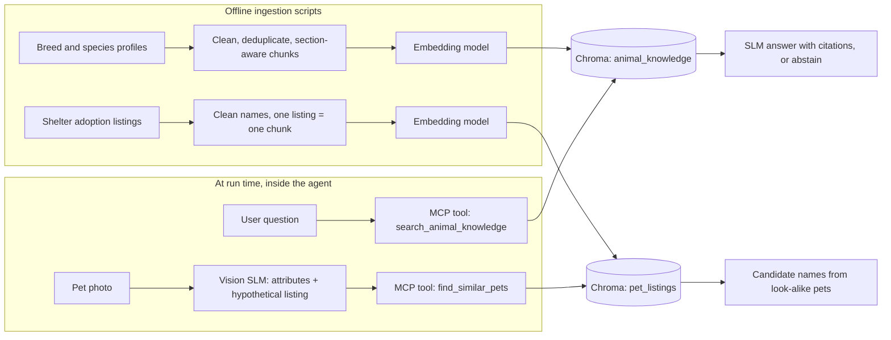
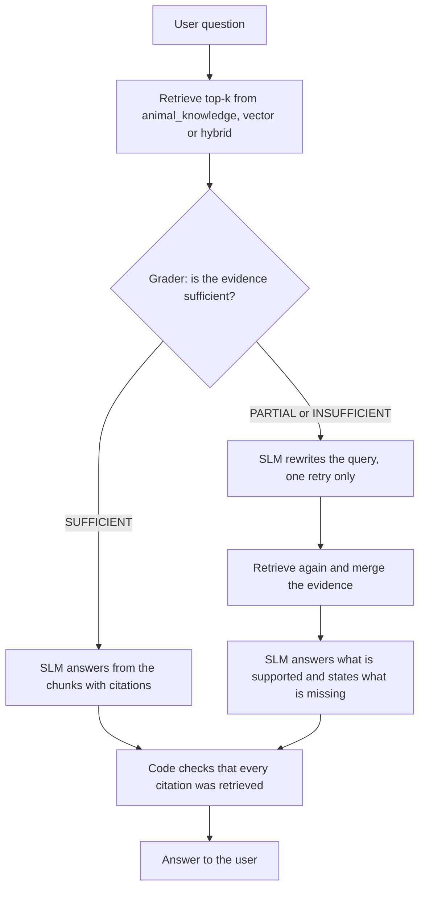
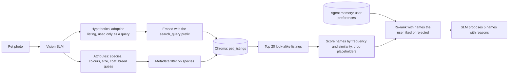

# Milestone 2 — Section 3: RAG design

> Part of the *What's their face* Milestone 2 architecture document. Sections follow the milestone brief:
> 1 Problem and data · 2 Golden dataset · **3 RAG design** · 4 Agent and tools · 5 Model choices · 6 Plan.

**Summary of choices**

- **Two separate indexes:** one for animal knowledge (facts, safety, care, lifestyle fit) and one for real shelter adoption listings (used to suggest names).
- **Chunking:** section-aware chunks for knowledge profiles, compared against fixed-size windows; one listing = one chunk for adoption data.
- **Embedding model:** `nomic-embed-text-v1.5` running locally, compared against BM25 and the smaller `bge-small-en-v1.5`.
- **Vector database:** Chroma, persistent and local, with metadata filters and idempotent `upsert` for new data.
- **RAG approaches compared:** basic RAG, hybrid retrieval, corrective RAG and agentic RAG for questions, plus a HyDE-style query for look-alike search from a photo.

---

## 3.1 What retrieval has to do in our system

The assistant needs retrieval for two jobs that look different, so we build **two separate indexes** instead of one shared index.

| | Knowledge retrieval | Look-alike retrieval |
|---|---|---|
| User need | "Is this animal dangerous?", "How much space does a Border Collie need?", "Would a cat suit a 10-hour workday?" | "Suggest a name for the pet in this photo" |
| What we search | Breed and species profiles | Real shelter adoption listings (name + appearance + description) |
| What we return | Cited passages the SLM answers from, or an explicit "not enough evidence" | The most similar real pets; their names become candidates |
| Main failure to avoid | Invented facts, especially false safety reassurance | Neighbours that do not look like the pet (wrong species, colour or size) |

Keeping them apart has three benefits. A listing such as "Ginger, orange tabby, very playful" never competes with a "Cat nutrition" section for the same top-k slots. Each index gets the chunking and metadata that fit its data. And each one is evaluated with the metric that fits its job (3.7).



## 3.2 Data in the indexes and ingesting new data

The final dataset choice is made in Section 1. The sources below are the candidates this design was made for.

| Collection | Unit stored | Candidate sources | Metadata per record |
|---|---|---|---|
| `animal_knowledge` | One section of one breed or species profile | Wikipedia breed and species articles; TheDogAPI / TheCatAPI breed records (temperament, size, life span) | `species`, `breed`, `section`, `source`, `chunk_id` |
| `pet_listings` | One adoption listing | PetFinder.my Adoption Prediction (Kaggle; about 15,000 dog and cat listings with name, breed, colours, size, free-text description and photos); Austin Animal Center outcomes (City of Austin open data; name, breed, colour, sex, age, no photos) | `listing_id`, `name`, `species`, `breed`, `colours`, `size`, `age_group`, `source` |

Ingestion is one offline script per collection and follows the Lab 3 pattern:

```text
load → normalise text → clean → deduplicate → chunk → embed → upsert into Chroma
```

- **Clean.** For listings we drop placeholder or unusable names ("No Name", "Puppy 1", names with digits, empty names) and listings that describe a whole litter instead of one animal. Kept names are normalised (case, whitespace, shelter markers such as a leading `*`).
- **Deduplicate.** Exact duplicates are removed by hashing the normalised text, as in Lab 3, so the same profile collected twice cannot take two of the top-k slots.
- **Stable IDs and upsert.** IDs are built from the source and position, for example `wikipedia/siberian_husky#exercise-0` or `petfinder/<PetID>`. Re-running ingestion updates changed records and inserts new ones without creating duplicates. This is how the system supports **new data**: add new profiles to the knowledge folder or a new listings export, then re-run the script.
- **One embedding model per collection.** The collection name and metadata record the embedding model (for example `pet_listings__nomic_v15`). Changing the model means building a new collection; vectors from different models are never mixed.
- **What is committed.** The ingestion scripts and the source data are committed. Where a licence does not allow redistribution (Kaggle competition data must be checked), we commit a download script instead. The generated Chroma folder is not committed; anyone can rebuild it with the scripts.

User preferences (names the user liked or rejected, animals they found cute) are **not** written into these shared indexes. They belong to the agent's per-user memory (Section 4) and are only used to re-rank candidates.

## 3.3 Chunking strategy

### Knowledge profiles: three strategies compared

| ID | Strategy | Why we test it |
|---|---|---|
| C1 | Fixed windows of 90 words with 15 words of overlap | Lab 3 default; our baseline |
| C2 | Fixed windows of 200 words with 40 words of overlap | Checks whether more context per chunk helps or only adds noise |
| C3 | **Section-aware:** split on the profile headings (Temperament, Size, Exercise, Grooming, Health, Diet, Safety, …). Sections longer than about 250 words are split again with overlap. Each chunk starts with `<Breed> — <Section>:` | Questions usually ask about one aspect of one breed. Fixed windows cut across sections and can produce a chunk such as "they need two hours of exercise a day" that never names the breed, so it cannot be matched or cited correctly |

We expect C3 to give the best hit rate, but the final choice comes from the measurements in 3.7 (experiment E1), not from this expectation.

### Adoption listings: one listing = one chunk

Listings are short and their fields only make sense together, so we do not split them. For each listing we build one text from its structured fields and its description:

```text
Cat. Breed: domestic short hair. Colours: orange, white. Size: medium. Age: young.
Coat: short. Description: very playful, loves climbing, a bit shy with strangers...
```

The **name is stored in metadata only, not in the embedded text.** At run time the query describes the user's pet and never contains a name, so names in the vectors would only add noise. Descriptions longer than about 150 words are truncated; most listings are much shorter.

## 3.4 Embedding model

**Main model: `nomic-embed-text-v1.5`**, served locally through LM Studio.

- It is the embedding model used in the course labs, so the setup is shared and reproducible on our laptops.
- Inference is local: no API cost, and user messages and photo descriptions stay on the machine.
- Its context window is long (8,192 tokens), so long profile sections are not silently truncated.
- It produces 768-dimensional vectors and supports Matryoshka truncation, so we can shrink vectors to 256 dimensions if index size or speed becomes a problem, without changing the model.
- The model card asks for task prefixes (`search_document: ` for indexed text, `search_query: ` for queries). The Lab 3 code does not use them; we measure both ways (experiment E2).

**Compared against:**

| Retriever | Why it is in the comparison |
|---|---|
| BM25 (lexical, no neural model) | Non-neural baseline. Breed names ("Shiba Inu", "Maine Coon") are exact terms, where lexical search can beat embeddings |
| `bge-small-en-v1.5` (384 dimensions, about 33M parameters) | Much smaller and faster on CPU; tells us whether the larger model is worth its cost |

**Stretch option: image embeddings (CLIP)** for look-alike search directly from photo to photo. Our main route is text (photo → vision SLM description → text embedding): it also works for listings without photos and every step can be inspected. If time allows, we compare it with a CLIP image-to-image route on the listings that have photos (experiment E6).

## 3.5 Vector database

**Chroma**, with a persistent local client and cosine distance (HNSW index).

- We used it in Lab 3, so the team already knows its API and its pitfalls.
- It runs inside the Python process and stores data in a local folder; there is no database server to deploy.
- It stores text, vector and metadata together and filters on metadata at query time, which we need: `where={"species": "cat"}` for look-alike search, `where={"breed": ..., "section": "Safety"}` for targeted knowledge lookups.
- `upsert` with stable IDs makes re-ingestion idempotent (3.2).
- Our scale is small: a few thousand knowledge chunks and tens of thousands of listings.

We use two collections: `animal_knowledge__<model>` and `pet_listings__<model>`.

**Alternatives considered:**

| Option | Why we did not choose it |
|---|---|
| FAISS | Fast, but it is only a vector index: metadata, filtering and persistence would be our own code |
| Qdrant / Weaviate | Good filtering, but they need a separate server, which our scale does not justify |
| PostgreSQL + pgvector | Useful when relational data must live next to the vectors; adds a database to run and maintain |

## 3.6 RAG approaches we will compare

All approaches use the same SLM (Section 5); only its role changes through the system prompt, as in Lab 3. Retrieval is always read-only, and every loop has a hard limit on extra calls.

| ID | Approach | Used for | Extra SLM calls | What it should fix / main risk |
|---|---|---|---|---|
| R0 | **Lexical retrieval** (BM25) only | Baseline for the retrieval metrics | 0 | — |
| R1 | **Basic RAG:** embed the question → top-k chunks → the SLM answers with citations or abstains | Reference for all knowledge questions | 0 | Answers from whatever was retrieved, even when it is not relevant |
| R2 | **Hybrid retrieval:** BM25 and vector results merged with Reciprocal Rank Fusion | Questions that name a specific breed | 0 | Catches exact breed names that embeddings can miss; may add lexical noise |
| R3 | **Corrective RAG:** a grader labels the evidence SUFFICIENT / PARTIAL / INSUFFICIENT; if it is not sufficient, the SLM rewrites the query and we search **once** more | Safety and care questions ("Is it dangerous?", "Can it eat grapes?") | 1–2 | A missing answer must become "I cannot confirm this", never a false reassurance. Risk: the grader can be wrong; higher latency |
| R4 | **Agentic RAG:** the agent decides which collection to search, with which filters, and whether to search again (**at most 2 searches**) | Mixed requests: "I live in a flat and work 10 hours a day. Would this dog suit me, and what should I call it?" | 1–2 | Combines both indexes in one turn. Risk: wrong tool or query; more calls |
| R5 | **HyDE-style look-alike query:** the vision SLM writes a *hypothetical adoption listing* for the pet in the photo, in the same template as the indexed listings, and that text is embedded as the query | Name suggestion | 0 (the vision call happens anyway) | Query and documents share one format, so similarity should be more meaningful. The hypothetical listing is **only a query, never evidence** |

### Knowledge question flow (corrective RAG, R3)



### Name suggestion pipeline



1. The vision SLM returns structured attributes (species, colours, size, coat, apparent breed) and the hypothetical listing text (R5). Baseline for comparison: embed a plain caption instead.
2. `find_similar_pets` retrieves the 20 most similar listings of the same species.
3. Candidate names are scored by how often they occur among these neighbours, weighted by similarity. Placeholders and duplicates are removed.
4. The SLM picks five names and explains each one from the neighbours, for example "orange, like the three retrieved cats named *Ginger*".
5. Names the user likes or rejects are saved in the agent memory and used to re-rank the next suggestions (Section 4).

### Grounding rules for every answer

- Answer only from retrieved chunks and cite their IDs.
- Application code checks that every cited ID was actually retrieved in this turn. An answer with an invalid citation is regenerated once, then rejected. A citation written by the model is a claim, not a proof.
- If the evidence does not support an answer, the assistant says so. For safety questions it never states that an animal or a food is safe without a supporting chunk.
- Vector distance is not treated as confidence. We report it, but it is never the only rule for refusing.

## 3.7 How we evaluate retrieval and RAG

Each comparison changes **one factor at a time** and keeps the same fixed golden set (Section 2), the same SLM and the same k.

**Knowledge retrieval**

- Hit rate @1 and @3: is the expected source among the top results? Every golden question for this index carries `expected_source` and `expected_section`.
- Unanswerable questions (facts absent from the corpus) are scored at answer level as refusal accuracy. We also report the distance of the nearest neighbour, because a nearest neighbour always exists, even when it is irrelevant.

**Answers**

- The Lab 3 rubric, adapted per question: covers the requested points; each fact has a valid citation; no unsupported claim; correct refusal when evidence is missing.
- Cost: number of SLM calls and total latency per approach.

**Look-alike retrieval and names**

- *Attribute precision@k:* held-out listings are used as queries (with their name hidden). We measure the share of the k neighbours that match the query pet's species, main colour and size.
- *Name hit@10:* is the held-out pet's real name among the 10 suggested names? Absolute values will be low because names are subjective, but it is a fair way to compare configurations.
- Human check: the team rates the suggestions for about 30 photos on a 1–5 scale for "fits how the animal looks".

**Experiments**

| ID | Question | Compared | Metrics |
|---|---|---|---|
| E1 | Which chunking strategy? | C1 vs C2 vs C3, all with nomic | hit@1, hit@3 |
| E2 | Which retriever and embedding model? | BM25 vs bge-small vs nomic; nomic with and without task prefixes | hit@1, hit@3, indexing time |
| E3 | Does hybrid search help? | Best retriever from E2 vs hybrid (R2) | hit@1, hit@3 on breed-specific questions |
| E4 | Which RAG architecture? | R1 vs R3 vs R4 | answer rubric, refusal accuracy, SLM calls, latency |
| E5 | How should we query look-alikes? | Plain caption vs hypothetical listing (R5) | attribute precision@10, name hit@10 |
| E6 (stretch) | Text route or image route? | R5 vs CLIP image-to-image | attribute precision@10, human rating |

## 3.8 Interface with the agent and the MCP server

Retrieval is exposed to the agent as two **read-only** MCP tools (the server itself is described in Section 4). Arguments are validated with Pydantic models that reject unknown fields, as in Lab 2.

```python
search_animal_knowledge(query: str, species: str | None = None, breed: str | None = None,
                        section: str | None = None, k: int = 3) -> list[KnowledgeHit]
# KnowledgeHit: citation, text, source, breed, section, distance

find_similar_pets(description: str, species: Literal["dog", "cat"], k: int = 20) -> list[ListingHit]
# ListingHit: listing_id, name, breed, colours, size, distance
```

Both tools only read, so they do not need user approval. Ingestion changes the indexes, so it stays an offline script and is **not** exposed as a tool the model can call.

## 3.9 RAG work plan (input to Section 6)

| Week | RAG work | Visible result in the repository |
|---|---|---|
| 7 | Ingestion scripts for both collections; data cleaning; BM25 baseline | Ingestion code, cleaning statistics, first hit@k numbers |
| 8 | E1 (chunking) and E2 (embedding models); choose the configuration | Results table for E1 and E2 |
| 9 | Look-alike search: listing template, name scoring, E5 | `find_similar_pets` working on held-out listings |
| 10 | Cited answers with citation check; R1 vs R3; E3 (hybrid) | Rubric scores for R1 and R3 |
| 11 | Both functions exposed as MCP tools; R4 through the agent; E4 complete | Tools callable from the agent |
| 12 | **Milestone review:** end-to-end demo (photo → names, question → cited answer) | All experiment tables committed |
| 13 | Failure analysis on wrong and unanswerable cases; hardening; E6 if time allows | Failure analysis notes |
| 14 | Final measurements and presentation | Final results |
