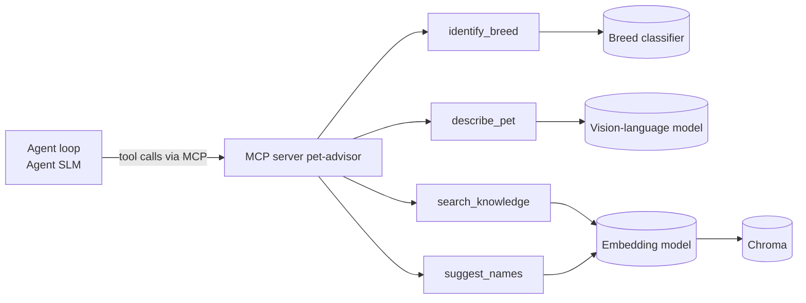

# Model choices

## Overview

- The system uses four models. Each one has one job, runs locally (laptops + LM Studio) and has at least one alternative we compare it with.
- We choose small models on purpose: they run at no cost, keep the user's photos on the device, respond fast enough for a chat, and let us compare several options.
- Rule we follow, as in the agent design: **the SLM decides what to do, code decides whether it is allowed.** So the SLM does not need to be perfect at facts or numbers; breed recommendation, confidence thresholds and citation checks are done in code.

| Job | Chosen model | Alternatives we compare with |
|---|---|---|
| Breed identification (`identify_breed`) | ConvNeXt-Tiny, ImageNet-pretrained, fine-tuned on Stanford Dogs | EfficientNet-B0, ViT-B/16, CLIP zero-shot |
| Pet description (`describe_pet`) | Small vision-language model (Qwen2.5-VL-3B) | SmolVLM, classifier + colour heuristic |
| Agent SLM (tool calling, corrective RAG, answers, name picking) | Qwen3-4B | Llama-3.2-3B, Phi-4-mini, and a ~1.7B model as a lower bound |
| Embeddings | nomic-embed-text-v1.5 | bge-small-en-v1.5, BM25 |

## How the models fit in the system

- The classifier and the VLM live behind MCP tools, so changing them never changes the agent.
- The embedding model is used inside `search_knowledge` and `suggest_names`, and when new data is ingested.
- The agent SLM is the only model that talks to the user.

## 1. Breed classifier (`identify_breed`)

**Why a fine-tuned classifier and not a vision-language model:**
- The label set is fixed (120 breeds), so a classification head is the natural fit.
- The confidence threshold lives in code (agent decision 2), so we need probabilities we can calibrate and tune. A VLM gives text, not usable probabilities.
- It runs quickly on CPU or a free GPU, and gives the same result every time for the same photo.

**Candidates and why:**
- **ConvNeXt-Tiny (main):** small, strong transfer learning on fine-grained image datasets, easy to fine-tune on a laptop or a free GPU.
- **EfficientNet-B0:** even smaller and faster; shows what we lose with a lighter model.
- **ViT-B/16:** a different architecture family (transformer); shows whether the bigger model is worth the cost.
- **CLIP zero-shot (baseline):** no training, breed names as text prompts. Shows how much fine-tuning adds over a ready-made model.

**Confidence:** temperature scaling on a validation split, so a score of 0.9 really means about 90% correct. The "confident / show top 2 / ask for another photo" threshold is then tuned on golden Part A.

**Known risks:**
- **Possible data leakage:** Stanford Dogs was built from ImageNet images, and our backbones are pre-trained on ImageNet, so they may have seen some test images. Accuracy on Stanford Dogs can look better than it is. We therefore also report results on a small set of photos from other sources.
- **Mixed and unknown breeds:** the model only knows 120 breeds and will always name one of them. Low-confidence handling in the agent is the mitigation, not a bigger model.

## 2. Pet description (`describe_pet`)

**Why a small VLM:**
- The breed classifier cannot say "brown and white" or "small and calm", and it only knows dog breeds, so it could not handle cats later. A VLM can describe what it sees in a fixed JSON format.
- It is used only for name suggestion, where listings are filtered by species and colour. In the MVP the photos are of dogs; the species field is there so that cats (a later extension) work without changing the tool.
- Errors here are low-risk: the user can correct the description in chat before names are suggested.

**Candidates and why:**
- **Qwen2.5-VL-3B (main):** good at following a JSON format and describing images, small enough for a laptop.
- **SmolVLM:** smaller and faster; shows what we lose with a lighter model.
- **Classifier + colour heuristic (baseline, no VLM):** breed classifier plus a simple colour measurement on the image. Shows whether the VLM is worth the extra model.

## 3. Agent SLM

**What a candidate must satisfy:**
- Tool calling works in LM Studio's OpenAI-compatible API.
- Produces valid JSON arguments for the 6 tools.
- Follows "answer only from the chunks and cite their IDs".
- Fits in about 8 GB of RAM on a team laptop with acceptable response time.
- Open licence that allows use in a course project.

**Why 3-4B models:**
- Below about 3B, tool calling and instruction following become unreliable. Above about 8B, response time and memory go beyond what our laptops can handle for a journey with several SLM calls per turn.
- The agent design already limits what the SLM can get wrong: few tools, state kept in code, limits and guards in code. So a small model should be enough, and the comparison shows how small we can go.

**Candidates and why:**

| Model | Why it is on the list |
|---|---|
| Qwen3-4B (main) | Supports tool calling and follows instructions well for its size; widely available in LM Studio |
| Llama-3.2-3B | Common reference model at 3B; a different training family |
| Phi-4-mini | Strong reasoning for its size; different training data |
| ~1.7B model | Lower bound: shows how small the agent can go before the journeys fail |

**How we choose between them:** same system prompt, same tool descriptions, same quantisation, temperature 0 for tool calls, so differences come from the model. We compare on the golden dataset: invalid tool-call rate, first-tool accuracy and journey completion (Part F), correct decline on vet and unanswerable questions (Part C), citation validity and correct facts (Part B), and seconds per journey.

**Reference model (not a candidate):** during development, a strong model (for example Claude Desktop connected to the MCP server) is used to check the tools. If a failure also happens there, the problem is in the tool; if not, it is in our SLM or prompt.

## 4. Embeddings

Decided in the RAG design: nomic-embed-text-v1.5 with the `search_document:` / `search_query:` prefixes, compared with BM25 and bge-small-en-v1.5. One Chroma collection per embedding model. Not repeated here.

## Fallbacks

| Risk | Fallback |
|---|---|
| Fine-tuning does not fit on our laptops | Free cloud GPU for training only, inference stays local; or train only a linear head on the pre-trained backbone |
| No candidate SLM calls tools reliably | Show fewer tools per step (the state tells which step of the journey we are in), or use the rule-based router for tool choice and the SLM only for wording |
| VLM too slow or too heavy | Classifier + colour heuristic (dogs only, which is all the MVP needs) |
