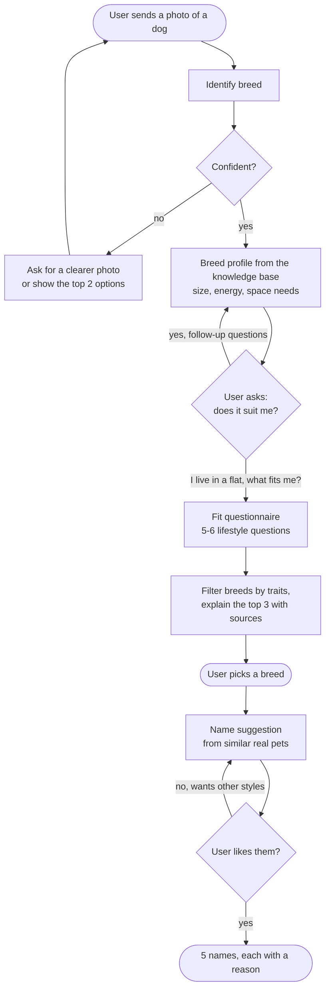

## Problem and data

### MVP user journey

A user sees a dog on the street, takes a photo and asks what breed it is. The agent answers "German Shepherd" and explains that it is very active and needs a lot of space. The user says they live in a flat and asks which breeds would suit them. The agent asks a few lifestyle questions, recommends breeds that fit, and once the user has chosen one, suggests names.

**Later extensions (not in the MVP):** cats and other species, danger warnings for wild animals, where to adopt, remembering which animals the user finds cute.

### What the system does at each step

| Step | Input | Output | Data used |
|---|---|---|---|
| 1. Identify breed | Photo | Breed, confidence, short profile | Stanford Dogs photos (only to test accuracy), knowledge collection |
| 2. Breed questions | Chat message | Answer with cited sources | Knowledge collection |
| 3. Fit questionnaire | 5–6 answers (home, time alone, walks, kids, allergies, experience) | Top 3 breeds, each with a reason | AKC breed traits, knowledge collection |
| 4. Name suggestion | Photo of the new dog, or the chosen breed plus a short description | 5 names, each with a reason | Listings collection |

### Datasets

| Dataset | Used for | Size | Why we chose it |
|---|---|---|---|
| Wikipedia breed articles + [TheDogAPI](https://thedogapi.com) | Knowledge collection (RAG) | One profile per breed | Free, covers facts, care and temperament as text |
| [AKC breed data](https://tmfilho.github.io/akcdata) | Fit questionnaire | 277 breeds | Gives numbers for energy, shedding, grooming, trainability, height and weight. A questionnaire needs values it can filter on, not free text. |
| [PetFinder.my Adoption Prediction](https://www.kaggle.com/c/petfinder-adoption-prediction) (Kaggle) | Listings collection (names) | ~15,000 dog and cat listings | The only public dataset we found with a real pet name, photo, breed, colour, size and description together |
| [Stanford Dogs](http://vision.stanford.edu/aditya86/ImageNetDogs/) | Testing breed identification | 120 breeds, 20,580 images | Standard benchmark with labelled breed photos |

- **Wikipedia + TheDogAPI:** articles and a free online database describing each dog breed (origin, size, temperament, care).
- **AKC breed data:** a table from the American Kennel Club, the largest US breed registry, that scores each breed on energy, shedding, grooming and trainability.
- **PetFinder.my:** adoption ads from a Malaysian pet adoption website, each with the pet's name, photos, breed, colour, size and the owner's description.
- **Stanford Dogs:** a research collection of dog photos, each labelled with its breed.

### Ingesting new data

To add new data, we put the new files in the `data` folder and run one script. The script checks that the files have the information we need, removes bad or duplicate entries, and adds the rest to the assistant's database (the RAG design section explains how). If an entry is already in the database, it is updated instead of added twice. At the end, the script shows how many entries were added, updated or skipped.

- **Adding a new dog breed:** we add its description and its scores. The assistant can then answer questions about it and recommend it, without any change to the code.
- **Adding another adoption website's data:** we rename its columns to match ours (name, breed, colour, size, age, description) and run the same script.

## Golden dataset

We test every step of the journey on the same fixed questions, so we can fairly compare different versions of the system.

| Part | Size | How we build it | Expected output | Metric |
|---|---|---|---|---|
| A. Breed ID | ~100 photos | Photos from the Stanford Dogs test split | The correct breed | Top-1 and top-3 accuracy; how often a wrong guess is flagged as "not sure" |
| B. Breed questions | ~60 | Pick a knowledge chunk, write a question it answers, the short answer and the chunk ID | Answer + source chunk ID | Hit rate at 1 and 3, correct facts, valid citations |
| C. Unanswerable / vet questions | ~15 | Questions our data can't answer, or that need a vet ("my dog ate chocolate") | "I don't know" or "see a vet" | % correctly declined |
| D. Fit profiles | ~20 | Questionnaire answers for realistic users (e.g. small flat, 9 hours at work, no experience) | Breeds that are acceptable + breeds that must **not** appear, decided by simple rules on the AKC scores, not by our opinion (e.g. small flat + long hours alone → no breed with the highest energy score) | No forbidden breed in the top 3; at least one acceptable breed in the top 3 |
| E. Names | ~50 | Held-out listings (photo + description) with the name hidden. These listings are removed from the listings collection. | The real name, plus a human rating | Real name in the top 5 (a weak signal); average 1–5 rating from 2 teammates who don't know which system produced the names |
| F. Full journeys | ~10 | Scripted conversations that follow the MVP journey | Correct tool order and final outcome | % of journeys completed with the right tools |

**Rules for building it:**

- Each part is written by a teammate who did not build that step, so the tests don't simply match our own system.
- An LLM may help draft paraphrases, but a person checks every item before it goes in.
- Stored in `eval/golden.jsonl` (one item per line: `id`, `part`, `input`, `expected`, `source_ids`), with photos in `eval/images/`.
